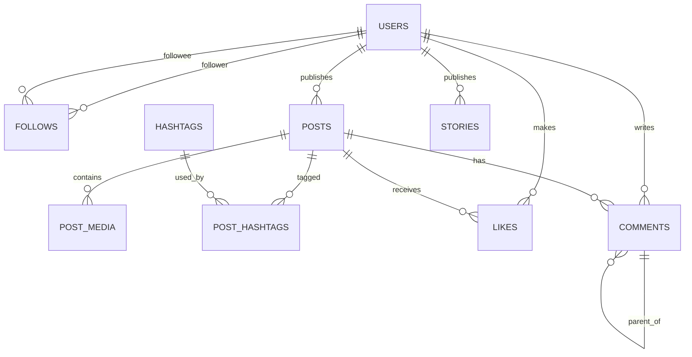

# Schema design

## Scope and validation status

This design models the nine CSV exports in `seed_data/` using the CSV file names
and headers as table and column names. The archive was checked before loading:
the row counts, candidate-key uniqueness, foreign-key references, and the
cross-row rules listed below were evaluated from the CSV data without printing
or including individual CSV rows in this document.

These are pre-load checks, not PostgreSQL load results. Re-run the checks after
`sql/01_schema.sql` and `sql/02_load_data.sql` have been executed, and record
the database command/output in this section before calling Phase 2 fully
verified.

## Data dictionary

`PK` means primary key, `FK` foreign key, `UQ` unique, and `NN` not null.
All ID columns use `BIGINT`; all `created_at`/`expires_at` columns use
`TIMESTAMPTZ` because the CSV timestamps include a UTC offset.

| Table | Columns (type, nullability, constraints) |
|---|---|
| `users` | `user_id BIGINT PK`; `username VARCHAR(30) NN UQ`; `full_name TEXT NN`; `email TEXT NN UQ`; `bio TEXT NULL`; `account_type TEXT NN CHECK`; `is_private BOOLEAN NN`; `is_verified BOOLEAN NN`; `followers_count INTEGER NN CHECK >= 0`; `following_count INTEGER NN CHECK >= 0`; `created_at TIMESTAMPTZ NN` |
| `follows` | `follower_id BIGINT PK/FK -> users.user_id`; `followee_id BIGINT PK/FK -> users.user_id`; `status TEXT NN CHECK`; `created_at TIMESTAMPTZ NN`; composite PK `(follower_id, followee_id)` |
| `hashtags` | `hashtag_id BIGINT PK`; `tag TEXT NN UQ CHECK` |
| `posts` | `post_id BIGINT PK`; `user_id BIGINT NN FK -> users.user_id`; `post_type TEXT NN CHECK`; `caption TEXT NULL`; `location_name TEXT NULL`; `like_count INTEGER NN CHECK >= 0`; `comment_count INTEGER NN CHECK >= 0`; `is_archived BOOLEAN NN`; `created_at TIMESTAMPTZ NN` |
| `post_hashtags` | `post_id BIGINT PK/FK -> posts.post_id`; `hashtag_id BIGINT PK/FK -> hashtags.hashtag_id`; composite PK `(post_id, hashtag_id)` |
| `post_media` | `post_id BIGINT PK/FK -> posts.post_id`; `position INTEGER PK CHECK >= 1`; `media_type TEXT NN CHECK`; `media_url TEXT NN`; `width INTEGER NN CHECK > 0`; `height INTEGER NN CHECK > 0`; `duration_sec NUMERIC NULL`; composite PK `(post_id, position)` |
| `likes` | `user_id BIGINT PK/FK -> users.user_id`; `post_id BIGINT PK/FK -> posts.post_id`; `created_at TIMESTAMPTZ NN`; composite PK `(user_id, post_id)` |
| `comments` | `comment_id BIGINT PK`; `post_id BIGINT NN FK -> posts.post_id`; `user_id BIGINT NN FK -> users.user_id`; `parent_comment_id BIGINT NULL`; `body TEXT NN`; `is_hidden BOOLEAN NN`; `created_at TIMESTAMPTZ NN`; `UNIQUE (comment_id, post_id)` supports the same-post parent FK |
| `stories` | `story_id BIGINT PK`; `user_id BIGINT NN FK -> users.user_id`; `media_type TEXT NN CHECK`; `created_at TIMESTAMPTZ NN`; `expires_at TIMESTAMPTZ NN CHECK`; `view_count INTEGER NN CHECK >= 0` |

Empty CSV fields observed in nullable columns:

| Column | Empty rows | Meaning |
|---|---:|---|
| `users.bio` | 13,429 | No bio supplied |
| `posts.caption` | 8,950 | No caption supplied |
| `posts.location_name` | 41,818 | No location supplied |
| `post_media.duration_sec` | 68,804 | Image media has no video duration |
| `comments.parent_comment_id` | 125,840 | Top-level comment, not a reply |

All other CSV columns were non-empty in this archive. Load the empty values as
SQL `NULL`, not empty strings.

## Keys, relationships, and deletion policy

| Relationship | Cardinality | Foreign key / deletion behavior |
|---|---|---|
| User follows user | M:N through `follows` | Both user references; cascade removal of a user's follow edges |
| User publishes posts | 1:N | `posts.user_id`; cascade a deleted user's posts |
| Post has media | 1:N | `post_media.post_id`; cascade with the post |
| Post uses hashtags | M:N through `post_hashtags` | Cascade mapping rows when either endpoint is deleted |
| User likes post | M:N through `likes` | Cascade likes when their user or post is deleted |
| Post has comments | 1:N | `comments.post_id`; cascade with the post |
| User writes comments | 1:N | `comments.user_id`; cascade on user deletion |
| Comment has replies | 1:N recursive | `(parent_comment_id, post_id)` references `(comment_id, post_id)`; a reply must belong to the same post; cascade replies when the parent is deleted |
| User publishes stories | 1:N | `stories.user_id`; cascade with the user |

`users.username`, `users.email`, and `hashtags.tag` are candidate keys in
addition to their primary keys. `post_media` is identified by its post and
position; `follows`, `likes`, and `post_hashtags` are identified by their
composite keys.

The primary-key and unique constraints create indexes automatically. No
performance indexes should be added in this phase.

## Check constraints

The following checks are supported by the observed values and the project
rules. Implement them as `CHECK` constraints unless noted otherwise:

1. `users.username` matches `^[a-z0-9._]{1,30}$`.
2. `users.account_type` is one of `PERSONAL`, `CREATOR`, `BUSINESS`.
3. A `BUSINESS` account is not private.
4. `users.followers_count >= 0`.
5. `users.following_count >= 0`.
6. `follows.follower_id <> follows.followee_id`.
7. `follows.status` is `ACCEPTED` or `PENDING`.
8. `hashtags.tag` matches `^[a-z0-9_]+$`.
9. `posts.post_type` is `PHOTO`, `VIDEO`, `CAROUSEL`, or `REEL`.
10. `posts.like_count >= 0`.
11. `posts.comment_count >= 0`.
12. `post_media.position >= 1`.
13. `post_media.media_type` is `IMAGE` or `VIDEO`.
14. `post_media.width > 0` and `post_media.height > 0`.
15. A `VIDEO` media row has a positive `duration_sec`; an `IMAGE` row has
    `duration_sec IS NULL`.
16. `comments.parent_comment_id` is null or references a comment on the same
    `post_id` (enforced with the composite self-referencing FK).
17. `stories.media_type` is `IMAGE` or `VIDEO`.
18. `stories.view_count >= 0`.
19. `stories.expires_at = stories.created_at + INTERVAL '24 hours'`.

The native `BOOLEAN` type is used for the CSV `t`/`f` columns. The requirement
that a carousel has at least two media rows is cross-row, so it is an
integrity query rather than a row-level `CHECK`.

## Normal forms and functional dependencies

Each relation is in BCNF under the candidate keys below: every non-trivial
functional dependency has a superkey on its left side. The two-column
association tables have no non-key attributes.

| Table | Functional dependencies |
|---|---|
| `users` | `user_id -> all other columns`; `username -> all other columns`; `email -> all other columns` |
| `follows` | `(follower_id, followee_id) -> status, created_at` |
| `hashtags` | `hashtag_id -> tag`; `tag -> hashtag_id` |
| `posts` | `post_id -> all other columns` |
| `post_hashtags` | `(post_id, hashtag_id) -> no non-key columns` |
| `post_media` | `(post_id, position) -> media_type, media_url, width, height, duration_sec` |
| `likes` | `(user_id, post_id) -> created_at` |
| `comments` | `comment_id -> post_id, user_id, parent_comment_id, body, is_hidden, created_at` |
| `stories` | `story_id -> user_id, media_type, created_at, expires_at, view_count` |

`followers_count`, `following_count`, `like_count`, and `comment_count` are
derived counters. They are retained because the workload reads them directly
and they avoid repeated aggregation, but writes must keep them synchronized.
In this snapshot, `followers_count` differs from the count of accepted follow
edges for 1,200 users; the other three counters match their corresponding
relationships. Do not add constraints that require these counters to equal
live relationship counts. `stories.expires_at` is derivable from
`created_at`; it is retained for direct expiry filtering and constrained to
exactly 24 hours after creation.

## ER diagram (Mermaid source)

Export this diagram to `diagrams/er_diagram.png` for the separate image
deliverable.

## Pre-load integrity-check results

These results were computed from the extracted CSVs; they still need to be
repeated against PostgreSQL after the schema and load scripts run.

| Check | Result |
|---|---:|
| Row counts: users / follows / hashtags / posts | 30,000 / 258,588 / 50 / 60,000 |
| Row counts: post_hashtags / post_media / likes / comments / stories | 150,000 / 89,854 / 419,954 / 150,000 / 40,000 |
| Duplicate primary/composite keys and duplicate usernames, emails, hashtag tags | 0 |
| Orphan foreign-key references, including missing comment parents | 0 |
| Replies whose parent is on a different post; self-follow rows | 0; 0 |
| Business accounts marked private; invalid username/tag patterns | 0; 0 |
| Media rows with invalid dimensions or image/video duration mismatch | 0; 0 |
| Stories not expiring exactly 24 hours after creation | 0 |
| Posts without media; carousels with fewer than two media rows | 0; 0 |
| Accepted-follow count differs from stored `followers_count` | 1,200 users |
| Stored `following_count`, post `like_count`, or post `comment_count` mismatch | 0 rows each |

The `followers_count` mismatch is a data-quality discrepancy in the provided
snapshot, not a load failure. Preserve the supplied values and document the
discrepancy rather than changing the seed rows.
